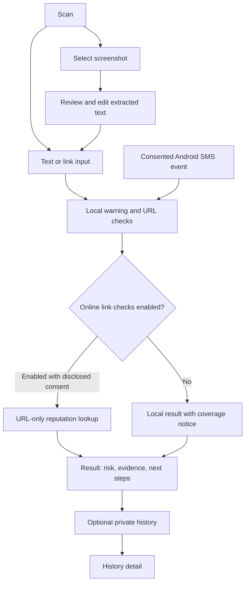

# Usisa design specification

Status: manual flows, the sideloaded Android SMS Lab and optional Groq AI assistance are implemented for the development MVP. Live reviewed-text AI has Android emulator evidence. See README for current validation and release limits.
Date: 9 November 2026.
Companion: [implementation plan](docs/superpowers/plans/2026-11-09-usisa-implementation.md).

## 1. Product and audience

Usisa helps people in the Philippines pause before acting on a suspicious message. It checks message text and URLs, explains warning signs, and recommends a practical next step. Typical content impersonates banks, e-wallets, government agencies, delivery services, or online sellers. People may be anxious, distracted, using an older phone, or unfamiliar with technical security language.

The primary job is: **“Help me decide what to do with this message before I tap, pay, reply, or share information.”**

Required capabilities:

- Manual scanning of typed or explicitly pasted text.
- A dedicated URL checker and per-link findings inside message results.
- Screenshot import, on-device OCR, and editable text review before analysis.
- Android incoming SMS checks after explicit consent, permissions, and distribution eligibility.
- Understandable risk classifications, quoted evidence, and safety recommendations.
- Optional Groq AI-assisted scanning of explicitly reviewed manual text, complementing the local algorithm. Automatic SMS detection stays local.

Detection cannot verify every sender or guarantee that content is safe. The app does not read private conversations in third-party messaging apps. It does not promise unrestricted or continuous monitoring.

## 2. Current project and proposed decisions

The project uses Dart/Flutter Material 3 with shared local rules, English/Filipino UI, on-device OCR, encrypted opt-in retention, and a consented URL-reputation gateway. Separate `manual` and `smsLab` Android flavors keep restricted SMS permissions out of the default build. Development identities remain `com.example.usisa` and `com.example.usisa.smslab`; signing and public release identity remain release gates.

Provider migration, 10 November 2026: the user requested a free alternative after Web Risk returned BILLING_DISABLED and confirmed noncommercial school/research use. **Google Safe Browsing is implemented**, including re-consent, linked attribution and expiry-aware warnings. Configured-key threat/no-match checks passed through the gateway and Android emulator. See [provider comparison](docs/free-url-providers.md) and [live validation](docs/provider-validation.md).

The following decisions define the approved implementation direction:

| Decision | Proposal and reason |
|---|---|
| Initial release | Android first; responsive phone and tablet layouts. Keep manual flows portable to iOS, but treat iOS release engineering as a later scope decision. |
| Architecture | Flutter Material 3, feature folders, SDK state tools, a shared Dart analysis engine, and small platform/service boundaries. |
| Account | No sign-in required. Checking a message should be immediately available. |
| Language | English and Filipino UI; analyze English, Filipino, and mixed Taglish without asking users to identify the language. Human review of Filipino copy is a release requirement. |
| Analysis | Deterministic rules locally for every scan and automatic SMS. Manual users may additionally request an independent Groq AI assessment after reviewing the text to send. URL reputation remains a separate consented service. |
| Retention | Session-only by default. Persistent history and draft restoration are separate opt-ins. |
| Visual identity | Calm deep teal, cool light surfaces, readable system type, evidence as the focal point. |

### Approaches considered

1. **Offline rules only:** smallest dependency and privacy footprint, but cannot identify known malicious links through a live threat list. Useful first milestone, incomplete as the full link intelligence experience.
2. **Local analysis plus optional online URL reputation — recommended:** keeps message/OCR processing local and works with limited connectivity; adds a narrow server boundary, provider costs, and explicit URL disclosure.
3. **Optional AI assistance — added by the user on 9 November 2026:** retain the recommended local core and add a manual Groq assessment for contextual, paraphrased, and obfuscated messages. This adds reviewed text transmission, operating cost, and separate evaluation. It does not replace local automatic SMS checks or establish perfect detection.

Do not present a paid tier, referral program, public dashboard, community blacklist, or account system as part of this release.

## 3. Experience principles

1. **Evidence before authority.** Say what was found, show the relevant words or host, and explain what to do. No “AI verified,” invented confidence percentages, or unexplained risk scores.
2. **Calm urgency.** High risk is clear without flashing red screens, alarm animations, blame, or exaggerated protection claims.
3. **One clear action.** Scan first; permissions, education, and retention choices appear in context.
4. **Preserve work.** Navigation, keyboard changes, retry, and recoverable errors preserve the current input in memory.
5. **Private by default.** Explicit paste, system image selection, local OCR, hidden notification previews, and disclosed online URL requests.
6. **Native expectations.** Material controls, Android system Back, visible labels, safe areas, large text, and accessible alternatives to gestures.

## 4. Information architecture and primary journeys

Three persistent destinations: **Scan**, **History**, and **Learn**. Settings opens from the top app bar. Results, screenshot review, and settings are secondary routes; Back returns to the previous input and destination.



Online consent defaults off. **Enable online link checks** explains that this setting sends URLs for this and future manually submitted scans until disabled; the alternative is **Keep local only**. Store that decision and its disclosure version. Do not ask again on every scan unless the provider/data disclosure changes. Background SMS checks remain local; checking their links online requires a foreground action with this consent enabled.

### First launch

Show a short explanation of what is checked, local processing, and the limits of a result. Primary action: **Start checking**. Offer language selection without requiring a profile. Save history and restore drafts default off. Do not request SMS or notification permissions on launch. People can reach a manual scan without granting either permission.

### Scan

- Heading: **Check before you tap.** Supporting text: “Paste a message, check a link, or choose a screenshot.”
- Segmented modes: **Text**, **Link**, **Screenshot**. Each retains its own session input.
- Text: visible “Message” label, multiline input, explicit **Paste text**, **Clear**, and **Check message** actions.
- Link: “Link” label, URL keyboard, **Paste link**, and **Check link**. Accept one HTTP(S) URL; explain unsupported schemes or extra URLs. Offer text mode for multiple links.
- Screenshot: **Choose screenshot** opens the system picker. Do not add camera capture or broad photo-library access for this requirement.
- Secondary SMS status: “Incoming SMS checks off,” “Permission needed,” “Unavailable in this build,” or “Incoming SMS checks enabled.” Never “You are protected.”
- Recent scans appear only when retention is enabled; otherwise show a small Learn suggestion rather than an empty dashboard of statistics.

### Screenshot review

Show the selected image and editable extracted text with **Check this text**, **Choose another image**, and **Cancel**. Explain that OCR can misread characters and links. An image with no readable text offers another selection and manual typing. Never auto-submit an OCR result. Delete app-created temporary copies on completion/cancel; never alter the original image in the user's library.

### Results

Read in this order:

1. Risk label, icon, one-sentence meaning, and coverage notice when incomplete.
2. The strongest actionable recommendation.
3. **Why this was flagged:** flat evidence rows, each with a short explanation and an exact original-text excerpt when available.
4. **Links in this message:** one row per distinct URL, its full host, local observations, reputation state, and checked time.
5. **What you can do:** two or three recommendations matched to findings.
6. Expandable original text, scan source, time, and analysis version.

Low risk copy: **“No common warning signs found. This does not verify who sent the message.”**
High risk example: **“This message asks for an OTP and pressures you to act. Do not share the code. Verify the request through the organization's official app or a contact you already trust.”**

URLs are selectable text, without automatic opening, embedded browsers, previews, or clickable links in quoted messages. Show the real host for `user@host` URLs; never crop the host to make room for a path. Label demonstration messages as synthetic and use reserved `.test` or `.example` domains.

### History

Use a flat reusable list row: risk label/icon, source, message preview, time, and coverage indicator. Preview truncation is acceptable here; detail preserves full content. Show a privacy explanation and **Enable private history** when retention is off, distinct from **No scans yet** when enabled.

Local search is debounced by 300 ms. Filters: risk, source (text/link/screenshot/SMS), and date (all/7 days/30 days). Active filters appear as removable chips with result count and **Clear filters**. Search and filters combine with AND. **Select** enters accessible selection mode; long press is an additional path. “Select all” means all matching results and names the count, including those offscreen.

Confirm bulk deletion and clearing all history. Single deletion offers a five-second Undo before durable removal; clear-all never offers a misleading Undo after encryption keys or records have been destroyed. Deleting saved scans never deletes SMS from the phone's messaging app. Missing/deleted result routes offer **Go to history** and **Start a new scan**.

### Learn and settings

Learn uses short articles: OTP/password requests, impersonated banks and e-wallets, government messages, delivery fees, seller payments, and what to do after sharing information. Explain that displayed sender names can be spoofed. Avoid unverified official phone numbers, affiliation claims, or report submission flows.

Settings contains language, system/light/dark appearance, private history, restore drafts, clear saved data, online link checks, and Android SMS/notification controls. Each permission shows its real state and a relevant recovery action. Do not show unsupported SMS toggles on iOS.

## 5. Screen sketches

Structure only; these are not rendered UI or approved visual mockups.

```text
SCAN                                  RESULT
┌────────────────────────────┐        ┌────────────────────────────┐
│ Usisa             Settings │        │ Back              Result   │
│                            │        │                            │
│ Check before you tap.      │        │ !  High risk               │
│ Check a message or link.   │        │ Do not share your OTP.     │
│                            │        │ Text checked · 1 link      │
│ [Text] [Link] [Screenshot] │        │ reputation not checked     │
│ Message                    │        │                            │
│ ┌────────────────────────┐ │        │ Why this was flagged       │
│ │ Paste or type here     │ │        │ Requests a security code   │
│ │                        │ │        │ “send your OTP”            │
│ └────────────────────────┘ │        │ Pressures you to act       │
│ Paste text          Clear  │        │ “within 10 minutes”        │
│                            │        │                            │
│ [     Check message      ] │        │ Links in this message      │
│                            │        │ bank-verify.example        │
│ Incoming SMS checks off    │        │ Not checked online         │
│                            │        │                            │
│ Scan     History     Learn │        │ What you can do ...        │
└────────────────────────────┘        └────────────────────────────┘
```

The distinctive interaction is evidence selection: tapping a warning row expands the original message and highlights its exact excerpt without opening any embedded URL. Always offer a plain text equivalent for assistive technology. Invalid/missing spans fall back to the explanation, never highlight unrelated characters.

## 6. Visual system

This palette is an original proposal. UI/UX Pro Max's design-system query and one narrower retry returned unrelated product styles; those outputs were discarded. Its Flutter/accessibility guidance and the other design skills informed the system below.

### 60:30:10 color distribution

Use the **60:30:10 rule** across the mobile UI in both light and dark themes. Treat these as approximate shares of visible UI color, not fixed layout dimensions or a requirement to leave 60% of a screen empty.

| Share | Role | Light theme | Dark theme | Where it appears |
|---|---|---|---|---|
| 60% | Dominant neutral | Background `#F5F8FA` | Background `#0E191E` | Screen canvas, open space, and the main reading area. |
| 30% | Supporting neutral | Surface `#FFFFFF` | Surface `#15262D` | Input panels, navigation, sheets, and grouped content surfaces. |
| 10% | Accent | Primary teal `#0B6B65` | Primary mint `#76D8CD` | Primary actions, selected navigation, focus cues, and a few meaningful highlights. |

Risk badges and warning panels use their semantic red, amber, or green within the accent share, replacing some teal emphasis rather than adding another decorative palette. Essential warnings may exceed that share when necessary for clarity. Keep their labels, evidence, and contrast fully visible; never reduce a warning to meet a percentage.

Use one visually dominant primary action per screen. Keep supporting sections neutral instead of filling every card, heading, and icon with teal. Text uses the semantic text tokens regardless of the approximate area shares. Imported screenshots and original message content do not need to conform to the palette. Review the balance in actual light/dark screen captures during implementation.

### Semantic color tokens

| Role | Light | Dark |
|---|---|---|
| Background | `#F5F8FA` | `#0E191E` |
| Surface | `#FFFFFF` | `#15262D` |
| Primary text | `#162B33` | `#EFF7F8` |
| Secondary text | `#52666D` | `#B7CDD2` |
| Primary action | `#0B6B65` | `#76D8CD` |
| On primary action | `#FFFFFF` | `#063C37` |
| Decorative separator | `#D7E1E5` | `#3A545E` |
| Control outline | `#6C818A` | `#78909A` |
| High risk text / container | `#A52A36` / `#FCEDEF` | `#FFA8AF` / `#3E2029` |
| Caution text / container | `#805100` / `#FFF4D9` | `#F2CE79` / `#382E18` |
| Low risk text / container | `#126354` / `#E4F5EE` | `#90DEBE` / `#16372F` |

Use explicit `ColorScheme` roles and a small risk-color `ThemeExtension`; no raw hex scattered through screens. Neutral/unknown uses secondary text on surface plus a written status. Do not use decorative separators as the only boundary of inputs. Keep risk colors consistent across themes; wallpaper-derived colors must not replace risk semantics. Brand teal indicates actions, not verified legitimacy.

### Typography

Use platform system typography: Roboto on Android and platform default on iOS. No remote font dependency. All sizes below are Flutter logical pixels before the user's text scaler.

| Role | Size / line height | Weight |
|---|---|---|
| Scan heading | 30 / 36 | 700 |
| Risk headline | 28 / 34 | 700 |
| Screen title | 24 / 30 | 600 |
| Section title | 20 / 26 | 600 |
| Body and entered message | 16 / 24 | 400 |
| Action label | 16 / 22 | 600 |
| Supporting text | 14 / 20 | 400 |
| Navigation label | 12 / 16 | 500 |

Map these roles to `TextTheme`. Sentence case, left aligned text, no tracked uppercase headings. Never shrink evidence or warnings to fit a fixed-height card.

### Layout and components

- Spacing scale: 4, 8, 12, 16, 24, 32, 48.
- Phone gutters: 20; 16 below 360 logical pixels. Tablet gutters: 32.
- Compact width below 600: three labeled `NavigationBar` destinations. From 600: `NavigationRail`. From 840: history may use list/detail with at least 320 logical pixels per pane; stack again when text scaling makes the split impractical.
- Form/result reading column max width: 720. Use available width and content constraints rather than orientation alone.
- Fields/buttons radius 12; substantial input/result panels 16; modal sheet upper corners 24. Pills only for chips and badges. Prefer flat evidence/history rows to nested cards.
- Buttons minimum height 52; every hit area at least 48 × 48; adjacent small targets separated by 8.
- Use native `FilledButton`, `OutlinedButton`, `SegmentedButton`, `TextField`, `FilterChip`, `SnackBar`, sheets, dialogs, and selection controls. Icons come from the existing Material icon font, with text/semantics.
- Respect status/navigation bars, cutouts, keyboard insets, Android Back, landscape, and scrollability. No sideways scrolling to read a message or URL.

### Motion and feedback

Native pressed feedback starts immediately. Shared targets: press 100 ms, inline crossfade 150 ms, result transition 200 ms, sheet 250 ms; use platform transitions where supplied. Motion answers an action and stays interruptible. No radar sweeps, flashing danger, confetti, card entrance cascades, or continuous background animation.

Respect system reduced motion: remove translation, bounce, and shimmer; retain instant updates or brief opacity changes. History may show size-stable static skeleton rows after 200 ms if still loading. Never delay completed work to display a loader. OCR and network work use honest stage text, no invented percentage.

## 7. Risk, coverage, and error contracts

Risk and completion are independent fields. Completed local analysis produces `low`, `caution`, or `high`; `unableToAssess` is a separate result state with no risk value. Link reputation state is one of `notRequested`, `checking`, `matched`, `noMatch`, or `unavailable`.

Proposed first rule policy, versioned as `rules-v1`:

| Evidence | Classification |
|---|---|
| Current Safe Browsing response reports a threat | High risk within its lifetime; name the threat category and source. |
| A request to disclose an OTP/password/PIN, or send money, combined with impersonation or pressure | High risk. Detect a request, not the mere presence of the word OTP. |
| Any other supported warning rule or URL anomaly | Caution; explain the exact finding. Brand mention or a legitimate OTP warning alone is not a warning rule. |
| No supported warning found after completed local analysis | Low risk, with the authenticity limitation. |
| Empty/unsupported input or analysis failed | No risk value; explain how to correct/retry. |

This is a proposed heuristic decision policy, not calibrated detection performance. Start with English/Filipino request, urgency, impersonation, prize, and advance-fee phrases; include negation and ordinary legitimate examples. Keep original text for evidence; normalization must retain a source-offset map or return explicit original spans. Never let case-folding/Unicode normalization corrupt evidence positions.

For links, flag credential-in-URL syntax, raw IP hosts, deceptive brand placement outside reviewed exact official domains, HTTP transport, recognized shorteners, and unusual/encoded host forms as separate observations. HTTPS, a `.ph` suffix, or a recognized domain does not prove the message legitimate. A no-match reputation response never clears a local finding. Do not claim to resolve shorteners, redirects, newly registered domains, or page content without implementing those checks.

| State | Required behavior |
|---|---|
| Initial / no history | One next action; distinguish retention off from an empty saved list. |
| Invalid input | Inline field error after submit/blur; preserve original content. |
| Reading screenshot | Preserve image and controls; cancellation is available. |
| Checking message/links | Keep input available; prevent duplicate submission for that revision. |
| Partial / offline | Show completed local findings plus “Link reputation not checked” or “Link check unavailable.” Retry only the failed lookup. |
| Scan failed | No low-risk fallback; retain text and show Retry. |
| Permission denied/revoked | Accurate capability status and Settings/manual-scan recovery. |
| Nothing matched filters | Explain active filters; offer Clear filters. |
| Missing saved scan | Explain it is unavailable and offer History/new scan. |
| Save failed | Keep session result visible and mark “Not saved”; do not claim persistence. |

No-result and not-checked link states never use a green success checkmark. When local findings are low but a link remains unchecked, the coverage notice appears beside the headline and says **“Link safety is unknown.”**

## 8. All 20 requested UX patterns

| # | Pattern | Application to Usisa |
|---|---|---|
| 1 | Optimistic UI updates | Adapt: immediate benign preference changes with rollback on save failure. Risk verdicts, permission grants, and completed checks wait for real confirmation. |
| 2 | Skeleton loaders | Adapt: explicit progress indicators during local initialization, OCR and SMS review. Defer list skeletons until a measured wait warrants them; no fabricated scan verdicts. |
| 3 | Command palette | Defer: direct scan actions fit a phone better. Reconsider for a larger desktop product. |
| 4 | Persistent sidebar navigation | Adapt: bottom navigation on phones, rail on wider layouts, preserved draft and scroll state. |
| 5 | Loading and empty states | Adopt: specify initial, empty, filtered-empty, loading, partial, offline, denied, failed, and success states. |
| 6 | Autosave | Adapt: preferences automatically save; in-memory input survives navigation; persistent drafts require opt-in. |
| 7 | Debouncing | Adopt: 300 ms history search; no automatic network requests while typing a message. |
| 8 | Throttling | Adapt: one active scan per revision, duplicate SMS event suppression, bounded server requests; distinct messages must not disappear. |
| 9 | Smart form validation | Adopt: visible labels, inline correction, whitespace checks, explicit input limits, and HTTP(S)-only URL mode. |
| 10 | Bulk list actions | Adopt for retained history: explicit selection, count, clear selection, and confirmed deletion. |
| 11 | Reusable data table | Adapt: shared history rows, filters and selection in a width-limited list; details open as a secondary route. No horizontally scrolling phone table. |
| 12 | Advanced filtering | Adopt a small useful subset: risk, source, date, combined search, count, and removable filters. |
| 13 | Keyboard shortcuts | Adapt: standard editing, focus traversal, Escape/back dismiss, Enter search; accessible visible actions remain primary. Multiline Enter inserts a newline. |
| 14 | Tier-based indicators | Adapt to risk labels with icon and explanation; no subscription tiers. Unavailable is not a risk tier. |
| 15 | Onboarding data capture | Adapt: one short first-run explanation and Start checking. Language and optional privacy preferences live in Settings; no name/email/phone or account. Permissions requested when used. |
| 16 | Referral and affiliate pages | Defer: outside the scam-checking task; never encourage sharing private scan content for growth. |
| 17 | Custom 404 page | Adapt: recoverable missing/deleted result route, including expired notification targets. |
| 18 | Mobile-optimized layouts | Adopt: 320 logical pixels upward, thumb-reachable actions, safe areas, keyboard handling, scalable text, tablet rail. |
| 19 | Destructive action protection | Adopt: confirmation for bulk/all deletion, reliable single-delete Undo, explicit draft clearing. |
| 20 | Graceful error recovery | Adopt: retained input, partial findings, specific Retry, cancellation and stale-response protection. |

## 9. Data, security, and platform boundaries

- Limit manual input to 10,000 Unicode code points, a URL to 2,048 characters, and ten distinct URLs per scan. Refuse excess with an editable explanation; never silently truncate. Preserve duplicate occurrences for evidence while looking up each distinct URL once.
- Decode images off the UI thread with a 20 MB compressed-file and 20-megapixel decoded-image ceiling; validate before OCR and explain oversized/unsupported files. Select suitable image scaling without discarding legible text.
- Keep ordinary session input/results in memory. Optional encrypted history exposes the latest 100 completed scans for at most 30 days; one optional encrypted text draft can be restored within 24 hours. Expired content is rejected on access, cleaned at foreground expiry deadlines, and cleaned again on startup/resume even when draft restoration is off. A closed/stopped app cannot guarantee physical deletion at an exact deadline: encrypted files can remain until next use. Disclose this before opt-in, surface cleanup failure, and offer immediate Clear saved data. Never retain screenshot files in history.
- Show the provider and last checked time next to each link. Safe Browsing warnings expire at the returned lifetime or a five-minute ceiling, whichever is sooner; request duration is subtracted and deadlines use device time to avoid server clock skew extending warnings. Expired Safe Browsing evidence cannot raise risk or show Google attribution; independent local findings remain. Permanent history saves local findings and check/source metadata without caching Safe Browsing verdicts. Existing Web Risk records keep their original source and explicitly historical warnings; they are never relabeled as Safe Browsing. No timer issues network requests.
- Scheme-less domain links are inspected with an explicitly disclosed assumed HTTPS scheme; the original text is preserved, and consent shows the exact URL to transmit. This does not fetch the page or validate HTTPS legitimacy.
- Prefer `flutter_secure_storage` for this bounded prototype store after measuring target-device size/latency. Persist each record separately and serialize mutations. If measured limits require a database, switch to an encrypted database rather than placing message content in preferences or plaintext files.
- Exclude retained scan content and temporary SMS data from Android cloud/device-transfer backups; persistent storage failure must be visible. Clearing saved data cancels in-flight saves and clears private drafts, history, and pending retained scan data without deleting phone SMS.
- Consent to URL reputation checking explains that the full URL, including path/query, reaches Usisa's gateway and its named reputation provider. That endpoint receives no message text, separately collected sender metadata, or screenshot. The separately consented AI endpoint receives only the final reviewed text and requested response language. Offer local-only checking. No background SMS uploads.
- A small service gateway keeps provider credentials server-side. URL reputation and AI scanning use separate endpoints and consent boundaries. Outbound calls use fixed provider APIs; never fetch submitted pages, expand redirects, or resolve arbitrary targets. Apply input limits, timeouts, abuse limits, and sanitized logs without URLs/message bodies. An embedded mobile secret is not authentication.
- Reputation provider: Google Safe Browsing v4 Lookup for the confirmed noncommercial school/research scope, with server-only credentials. Require re-consent under disclosure version2, qualified warning copy and linked Google advisory attribution only for current Google evidence. Provider no-match means not listed, not safe. Reassess licensing before commercial use.
- SMS support is a gated Android capability, not a switch that can manufacture permission eligibility. Google Play restricts SMS permissions and its anti-smishing exception has evidence/review requirements. Prototype receipt and background processing on actual target Android versions before promising the feature. [SMS policy](https://support.google.com/googleplay/android-developer/answer/10208820)
- Request only capabilities actually used: no contact access, SMS sending/deletion, bulk inbox reading, accessibility-service scraping, or notification-listener workaround. Runtime consent and store approval are separate requirements.
- SMS alerts are generic by default: “A message needs your review.” No sender/body/URL on the lock screen. Notification permission is separate on Android 13+. Turning checks off stops new processing and clears pending jobs. [Android notifications](https://developer.android.com/develop/ui/compose/notifications/notification-permission)
- Enabling SMS checks also discloses temporary encrypted processing storage: at most 20 events, expiring 15 minutes after receipt, excluded from backup. This is separate from optional permanent history. Alerts may be delayed by Android scheduling; no checks are promised while force-stopped. If the queue fills, mark checks degraded and report that some messages could not be checked instead of silently claiming coverage. [Android persistent work](https://developer.android.com/develop/background-work/background-tasks/persistent)
- The native temporary SMS queue owns a durable privacy generation and serialized commit gate. Each event captures it; completion and notification dispatch recheck it. Disabling SMS or clearing saved data invalidates pending work and erases its records/notifications. Permanent history has one foreground writer with an independent erasure generation; clear-all waits for both native invalidation and serialized local erasure. Foreground import captures both scopes, so a delayed import cannot undo a clear. History and draft preferences remain independent. A future background history writer must use a durable shared gate before it is introduced.
- Temporary SMS reviews become inaccessible after 15 minutes. WorkManager schedules encrypted-file cleanup, and every queue access also rejects/deletes expired content. Android can delay cleanup or prevent it while force-stopped; physical deletion at an exact wall-clock deadline is not promised. Only a result explicitly opened with history enabled may remain in the separate 30-day history.

## 10. Accessibility, evaluation, and completion

Design and implementation must support TalkBack, logical focus order, meaningful control labels, selected/disabled states, visible focus, and a single announcement of result/error changes. All gesture actions have buttons. Color, haptics, and animation never carry risk meaning alone.

Require 4.5:1 contrast for ordinary text and 3:1 for large text and essential control outlines. Validate actual composed controls in both themes. Check at 320, 390, 600, and 840 logical pixels, landscape, keyboard open, and at least 200% text scaling; do not clamp OS scaling. The reading order is risk, coverage, recommendation, evidence, then details. [Flutter accessibility](https://docs.flutter.dev/ui/accessibility)

Use synthetic/de-identified English, Filipino, and Taglish evaluation cases, including legitimate bank notices, legitimate OTP warnings, payment requests, hostile URLs, and ambiguous messages. Keep rule-development examples separate from held-out evaluation. Report precision, recall, false-positive rate, per-language/per-category results, and sample counts; set deployment thresholds from reviewed data rather than claiming an invented accuracy figure. Evaluate OCR transcription separately because an incorrect URL changes the subsequent check.

Acceptance includes no/one/100 retained scans; storage expiry; long emoji/combining-character text; URLs with long queries and deceptive hosts; blank/partial OCR; multiple mixed-status links; offline launch; network loss; cancelled/retried scan; permission revocation; background app/process loss; expired notification targets; dark mode; large text; and reduced motion.

Success criteria: a person can start a manual scan without an account or SMS permission, understand a finding and next step, see exactly which checks were incomplete, recover input after failure, and erase retained app data. Public claims about detection and automatic SMS availability require evaluation and platform evidence.

## 11. Design sources and remaining release decisions

Skills used: UI/UX Pro Max; Frontend Design; Impeccable (planning/Operate guidance); Apple Design; Emil Design Engineering; Taste; transferable mobile-native, animation-performance, break-ui, and Web Design Guidelines principles. Web CSS/React/GSAP prescriptions do not apply to this Flutter specification. Brainstorming and Writing Plans guide the documents; this specification is awaiting review, not an approved implementation.

Primary technical references checked on 9 November 2026:

- [Flutter architecture recommendations](https://docs.flutter.dev/app-architecture/recommendations): adapt SDK state and separation of concerns to project size.
- [ML Kit text recognition](https://developers.google.com/ml-kit/vision/text-recognition/v2/android): bundled recognizer supports immediate model availability; follow its current SDK requirements when selecting the Flutter wrapper.
- [Web Risk Lookup](https://docs.cloud.google.com/web-risk/docs/lookup-api): URL threat-list lookup with match types and expiration.
- [Safe Browsing Lookup](https://developers.google.com/safe-browsing/v4/lookup-api) and [usage requirements](https://developers.google.com/safe-browsing/v4/usage-limits): current free noncommercial provider, attribution and warning expiry.
- [Android broadcasts](https://developer.android.com/develop/background-work/background-tasks/broadcasts/broadcast-exceptions): background broadcast rules are only one part of capability feasibility.

Release decisions with external dependencies: SMS distribution/permission eligibility, public gateway hosting/quotas, final application ID and signing identity, reviewed local language content, and measured detection thresholds. Local Safe Browsing credentials and live validation are complete; no public hosting or production-release readiness is implied.

## 12. Groq AI-assisted scanning

Planned on 9 November and explicitly included in the MVP by the user on 10 November 2026. Implemented with server-only Groq calls, editable review, per-submission confirmation and separate local/AI evidence. Detailed delivery plan: [Groq AI scanning](docs/superpowers/plans/2026-11-09-groq-ai-scanning.md).

### Purpose and analysis modes

The local algorithm remains fast, offline, and useful for consented incoming SMS. Optional AI analysis adds context for indirect requests, paraphrases, mixed Taglish, and wording designed to avoid simple phrase rules. Both approaches can be bypassed and can misclassify content; do not describe AI as foolproof or assume broader language accuracy without evaluation.

Manual Text, Link and Screenshot remain input modes. Add a separate, clearly labeled analysis choice: **On-device** (default) or **AI assisted**. The latter still runs local checks and requests an independent AI assessment; do not send local scores/findings to the model or make the AI merely restate the algorithm. AI selection never changes automatic SMS behavior.

### User journey and privacy

1. Enter/paste text or review locally extracted screenshot text.
2. Select **AI assisted** and tap **Review for AI check**.
3. Show the exact editable text that will leave the device. Explain: “This text will be sent to Usisa's server and Groq for an AI assessment. Remove any codes or personal details you do not want to share.” Names, numbers and URLs inside that text are included unless the user edits them. Do not promise automatic removal of sensitive data.
4. **Send this text for AI check** confirms only this submission. **Keep on device** returns to local analysis. No AI uploads from typing, clipboard polling, background tasks, or opening a saved result. No persistent conversation is created.
5. Run local analysis on the final reviewed text as well. If the user changed the text, mark it as the reviewed version; do not merge results from two different texts into one verdict.
6. Preserve the input and completed local result while AI is checking. Offer Cancel, then retry only on an explicit action after failure.

OCR remains on-device; the image, image metadata, contacts and separately collected SMS sender data never go to the AI endpoint. An SMS result can be sent only after the user opens it, reviews the text and confirms the manual action. URL reputation consent does not authorize AI text uploads; AI consent does not enable URL reputation checks.

### Result presentation

Show one conservative headline plus separate **On-device findings** and **AI assessment** sections. The overall assessed risk is the highest of local risk, validated AI risk, and a matched reputation threat. AI low risk never erases a deterministic warning or a threat-list match. Explain disagreement instead of implying consensus.

AI coverage states: not requested, checking, completed, unable to assess, unavailable, and cancelled. A timeout/refusal/schema failure is not low risk. Use “On-device checks complete; AI assessment unavailable” when appropriate. An AI-only high finding is visibly attributed to AI and accompanied by its matching quoted evidence. No confidence percentage, “AI verified,” or “safe” certification.

Require short quoted evidence that appears exactly in the submitted reviewed text; validate it server-side. Model prose is plain text, never executable markup or active links. Recommendations come from the app's reviewed safety-action codes. The model must not invent contact numbers, claim to have visited URLs, or assert real-time threat intelligence. A separate reputation service owns that check.

The existing 60:30:10 palette, accessible risk colors, type scale, loading states, reduced motion and 48-pixel hit targets apply. AI uses the same teal action system; it does not add a competing color palette, animated mascot, chat UI or fake thinking progress.

### Model and configuration

The configured development model is `openai/gpt-oss-120b`, with prompt `ph-scam-v1`, low reasoning effort, strict structured output and suppressed reasoning output. Compare `openai/gpt-oss-20b` for latency/cost before changing the default. Both support strict structured outputs; there is no automatic fallback model. A 20-message held-out synthetic diagnostic is recorded in `docs/ai-evaluation.md`; it does not establish real-world Philippine scam accuracy. [Models](https://console.groq.com/docs/models), [structured outputs](https://console.groq.com/docs/structured-outputs)

Use server-only `GROQ_API_KEY` and `GROQ_MODEL`. The ignored worktree-root `.env` already contains both; implementation changed neither value. No key belongs in Flutter assets, Dart defines, source, logs or browser bundles. Only synthetic fixtures were used for live verification. Standard APKs need a configured public gateway URL to use AI; emulator development uses `http://10.0.2.2:8787`.

The loopback gateway limits AI to ten requests/minute/socket IP, four concurrent calls and 50 calls/day/process by default (`AI_DAILY_LIMIT`). Its daily counter resets on restart and is not an account spending limit. It coalesces matching in-flight submission keys and aborts disconnected work where possible, with a 15-second provider deadline and no automatic retries. Mobile requests time out after 18 seconds; cancellation or backgrounding makes late responses inert. Reopening history never resumes an upload. Public deployment needs trusted ingress and verified account spending controls.

Review Groq account data controls before release. Provider retention depends on those controls and service conditions; do not promise zero retention from an API key alone. The app gateway does not retain raw prompts or responses in logs, caches, traces, or analytics. [Groq data controls](https://console.groq.com/docs/your-data)
