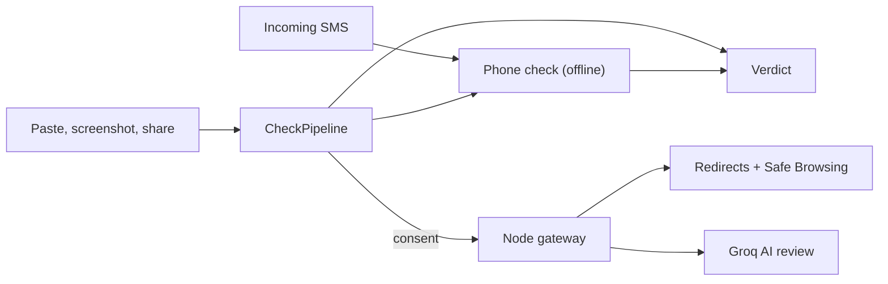

# Usisa

Checks suspicious messages, links and screenshots for scams in the Philippines.


## Why use this

- Check a pasted message, a link, a screenshot, a photo, or content shared from another app.
- The phone check runs first and works offline. Online checks ask for consent.
- See where a link really goes, after redirects, and whether Google Safe Browsing flags it.
- Get warned about scam texts as they arrive (Auto SMS protection, opt-in).
- Use it in English or Filipino.

Verdicts are heuristic. They never guarantee that content is safe or malicious.

## Prerequisites

| Tool | Version | Needed for |
|---|---|---|
| Git | any | Cloning |
| Flutter (includes Dart 3.13.4) | 3.47.5 | Everything in the app |
| Android SDK and JDK | JDK 17 | Android builds; minimum Android SDK 24 |
| Android emulator or phone with USB debugging | API 24+ | Running the app |
| Node.js | 24+ | Only for running the gateway locally |

`adb` (Android SDK `platform-tools`) must be on your `PATH` for the `adb` commands below. Run `flutter doctor` to check the setup.

## Quick start

Start an emulator or connect a phone, then:

```sh
git clone https://github.com/heliokii/Usisa.git
cd Usisa
flutter run
```

No API keys are needed. The app uses the hosted gateway at https://usisa-gateway.onrender.com for online checks. Its first request after a quiet spell can take up to a minute.

## Configuration

Only needed to run your own gateway. API keys stay on the gateway, never in Flutter assets or `--dart-define`.

1. From the project root, copy the example file. This overwrites an existing `.env`.

   ```sh
   cp .env.example .env
   ```

2. Fill in the keys:

   | Variable | Purpose |
   |---|---|
   | `GROQ_API_KEY` | Turns on AI review ([Groq](https://console.groq.com/keys)) |
   | `GROQ_MODEL` | Must be on the allow-list in `server/ai_scan.mjs`; the example value works |
   | `SAFE_BROWSING_API_KEY` | Turns on link checks ([Google Safe Browsing](https://developers.google.com/safe-browsing)) |

3. Start the gateway (no `npm install`, it has no dependencies):

   ```sh
   cd server
   npm start
   ```

4. In a second terminal, from the project root, point the app at it.

   Emulator:

   ```sh
   flutter run --dart-define=USISA_GATEWAY_URL=http://10.0.2.2:8787
   ```

   Phone over USB:

   ```sh
   adb reverse tcp:8787 tcp:8787
   flutter run --dart-define=USISA_GATEWAY_URL=http://127.0.0.1:8787
   ```

All variables, endpoints, rate limits and timeouts: [server/README.md](server/README.md).

## Commands

Run from the project root unless the command changes directory.

| Command | What it does |
|---|---|
| `flutter pub get` | Fetch packages |
| `flutter gen-l10n` | Regenerate localizations after editing `lib/l10n/*.arb` |
| `flutter analyze` | Lint |
| `flutter build apk --debug` | Debug APK in `build/app/outputs/flutter-apk/` |
| `flutter build apk --release` | Signed APK; needs `android/key.properties` |
| `dart run tool/release_gate.dart` | Analyze, tests and phone-only evaluation; fails on any miss |
| `npm --prefix server start` | Run the gateway |

There is one build, with no flavors. The application ID is `com.usisa.app`.

## Architecture



| Path | Contents |
|---|---|
| `lib/main.dart`, `lib/app.dart` | Entry points and tab shell: Check, History, Learn, Settings |
| `lib/features/check/` | Check pipeline (`check.dart`), phone check, screens |
| `lib/features/sms/` | SMS setup and background check |
| `lib/features/history/` | Encrypted on-device History |
| `lib/l10n/` | English and Filipino strings |
| `android/app/src/main/kotlin/` | SMS receiver, workers, alerts, share bridge |
| `server/` | Gateway: plain `node:http`, holds the API keys |
| `tool/` | Evaluation, evaluation-set builder, release gate |

## Testing

| Command | What it runs |
|---|---|
| `flutter test` | Dart unit and widget tests |
| `flutter test tool/evaluate.dart` | Phone-only Quality bar evaluation |
| `npm --prefix server test` | Gateway tests |
| `cd android && ./gradlew :app:testDebugUnitTest` | Kotlin unit tests |
| `cd android && ./gradlew :app:connectedDebugAndroidTest` | Instrumentation tests; needs a device or emulator |

The `gradlew` script is not in Git. `flutter build apk --debug` creates it. In Windows PowerShell 5.1, run `cd android`, then `.\gradlew.bat :app:testDebugUnitTest`.

### Manual SMS check (emulator)

1. `flutter run` on an emulator, turn on **Auto SMS protection** on the home card, and allow SMS and notifications.
2. Send a harmless text. The card should count "1 text checked today". Nothing is saved for it.

   ```sh
   adb emu sms send 09171234567 "Hi Ma, uuwi ako mamaya"
   ```

3. Send a scam text. A "Dangerous text" notification should appear, with the message hidden on the lock screen. Tapping it runs the check, and History marks it "From your texts".

   ```sh
   adb emu sms send 09171234567 "Your GCash account is locked. Verify at http://gcash-verify.example now"
   ```

4. If nothing changes, watch the log:

   ```sh
   adb logcat -s WM-WorkerWrapper:I flutter:I
   ```

More sample content: [MOCK_TEST.md](MOCK_TEST.md). Real-phone checks: [SMS_PHONE_CHECKLIST.md](SMS_PHONE_CHECKLIST.md).

## Deployment

- **App:** signed APK, see [RELEASE.md](RELEASE.md).
- **Gateway:** Render Free web service, see [server/README.md](server/README.md#deploying-on-render). The Free plan is not meant for production.

## Customization

- **Detection rules:** `lib/features/check/phone_check.dart` (pure Dart). Tune on the development split only.
- **Text:** edit both `app_en.arb` and `app_fil.arb`, then run `flutter gen-l10n`.
- **AI warning codes:** change `server/ai_schema.mjs`, `lib/features/scan/ai_models.dart` and the `.arb` files together.
- **Terms and design:** [GLOSSARY.md](GLOSSARY.md), [DESIGN.md](DESIGN.md).

## Known limits

- The SMS flow has unit tests but needs the manual check above end to end. Phone-maker battery managers (Xiaomi, Oppo, Vivo, Samsung) can stop it.
- The iOS build is not validated.
- Filipino safety copy still needs human review.
- Detection quality needs measurement against independently labelled Philippine examples.

## License

No `LICENSE` file, so reuse terms for the code are not specified. Evaluation data in `test/fixtures/evaluation/` carries its own terms; the Kaggle-derived files are CC BY-NC-SA 4.0 (non-commercial).
